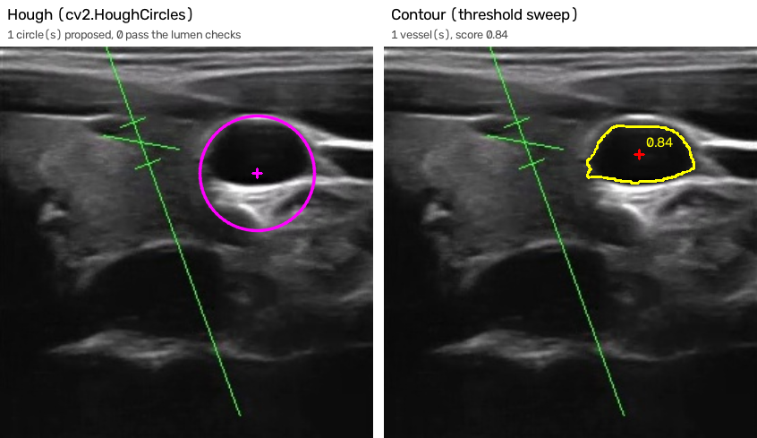

# Detect Circular Vessels

Finds vessels cut crosswise (transverse view) in a B-mode image that is already cropped to the view, and writes each vessel's outline, size and score.

## How to Run

From the repo root, with the shared environment active (`source .venv/bin/activate`):

```bash
python modules/detect_circular_vessels/src/main.py                    # data/detect_circular_vessels/input/ -> output/
python modules/detect_circular_vessels/src/main.py INPUT OUTPUT       # INPUT: one image or a folder of images
python modules/detect_circular_vessels/src/main.py --show             # also show each result in a window
```

Input images must already be cropped to the B-mode view (the crop comes from an
earlier stage). Optional flags:

| Flag | Default | Meaning |
|---|---|---|
| `--method contour\|hough` | `contour` | how candidate lumens are found (see below) |
| `--min-circularity C` | 0.75 | convex-hull circularity, 0..1 (1 = perfect circle) |
| `--min-aspect A` | 0.4 | ellipse minor/major axis ratio |
| `--min-contrast K` | 30 | wall brightness minus lumen brightness, 0..255 |
| `--show` | off | display each overlay (any key: next, q: close the window) |

The same defaults are the constants at the top of `src/main.py` (`METHOD`,
`MIN_CIRCULARITY`, `MIN_ASPECT`, `MIN_CONTRAST`, `SHOW`). From Python, or from
the harness, call `run(input, output)`; it uses those constants.

## What it Does

Finds vessels cut crosswise (transverse view) in a B-mode / colour Doppler image:
a dark, roughly round lumen with a brighter wall around it.

1. **Resize** (`to_work_size`): scale the image so its shorter side is 300 px.
2. **Clean the view** (`clean_view`):
   - Colour-flow pixels (red/yellow/blue hue) are set to black, so flowing
     blood counts as lumen.
   - Other coloured overlays (green Doppler cursor, cyan colour box) are
     painted over with `cv2.inpaint`.
   - Flow blobs that touch the colour box are marked as clipped.
3. **Find candidates** (`dark_regions`): blur the image (median 5 + Gaussian
   σ 2), then threshold it at every darkness level from 10 to 90 in steps of 5.
   Every dark blob of a plausible size (radius 3–35% of the image) at every
   level is a candidate.
4. **Measure each candidate** (`measure`): area, fitted ellipse (centre,
   major/minor axis), circularity, solidity, and the contrast between the
   lumen and a thin ring just outside it (the wall).
5. **Filter** (`is_circular`): keep candidates that don't touch the image edge,
   are not mostly clipped flow, pass the circularity / aspect / solidity (≥ 0.9)
   / contrast thresholds, and whose lumen is under 60% of the wall's brightness.
6. **Score** (`score`): `0.6 × mean(circularity, aspect, solidity) + 0.4 × min(1, contrast / 80)`, 0..1.
7. **Merge** (`suppress`): the same vessel is found at several levels; keep the
   highest-scoring candidate and drop any other that overlaps it by ≥ 30%.
8. **Scale back and write**: positions and sizes are converted back to input-image pixels.

`--method hough` replaces step 3 with `cv2.HoughCircles` (HOUGH_GRADIENT_ALT);
steps 4–8 are the same.

Files written to OUTPUT:

| File | Contents |
|---|---|
| `<image name>` | the input image with each detection drawn: yellow = lumen outline, red cross = centre, number = score |
| `detections.csv` | one row per detection (an image with no detection has no row) |

`detections.csv` columns (all in input-image pixels):

| Column | Meaning |
|---|---|
| `image` | input file name |
| `cx`, `cy` | centre of the fitted ellipse |
| `radius` | equivalent-area radius, √(area / π) of the traced outline; not the ellipse's radius |
| `major`, `minor` | full axis lengths (diameters) of the fitted ellipse |
| `circularity`, `aspect` | shape measures, 1 = circle |
| `contrast` | wall minus lumen brightness |
| `color_flow` | True if more than 20% of the lumen is colour flow |
| `score` | 0..1 confidence (see step 6) |

`data/detect_circular_vessels/output/steps/` holds per-step images of the
contour method for the sample inputs. They were made with a one-off script and
are not produced by this module.

On the sample inputs, the transverse artery in `frame_006090.jpg` and
`example_transverse.png` scores 0.84; `frame_012000.jpg` (a longitudinal view)
gets one small false detection at 0.61; `frame_004920.jpg` gets none.

## Design Decision

The initial approach had two options to follow, a classic OpenCV approach or a machine learning approach. Due to the amount of data needed to train the machine learning and the deadline for verifying the code in the throwaway test, we stuck with using a classical OpenCV approach.

When it came to the OpenCV approach, the approach later breaks into either using a Hough or Contour approach. A Contour approach involves looking at and connecting dark blobs, relying on the lumen being darker than its surroundings. A Hough approach attempts to find the circular edges at places where brightness changes sharply. After trying both on the same input image, we found that both approaches can find the vessel but Hough cannot accurately outline it due to the circle not fitting the lumen, so it fails the lumen checks.



*Same frame (006090, enlarged). Left: the circle Hough proposes (magenta) covers
the lumen plus the bright wall below it, so it fails the lumen checks. Right: the
contour method outlines the dark lumen itself (yellow, score 0.84).*

When using a Contour threshold to determine the lumen, it is also difficult to select the best threshold between what is considered the lumen and not. A single darkness cutoff either catches only parts of the lumen or merges it with nearby dark tissue. Between different frames, the right cutoff also changes. To circumvent this, we can use multiple thresholds in a threshold sweep.

Inside the threshold sweep, we calculate the score of the outline in each threshold, and keep the outline with the highest score. The score is based on the shape (roughly circular-ish) and the contrast. The main feature we look at is the high contrast between the brighter ring around the lumen and the dark lumen inside (a result of the connective tissue of the artery wall).

Other details:

- **Fixed working size (300 px):** the blur, the 5×5 cleanup shape and the
  minimum wall-ring width are in pixels. Resizing every input to the same size
  makes those settings behave the same whatever resolution the crop stage gives.
- **Colour flow counts as lumen; overlays are removed:** colour Doppler fills
  the lumen with red/blue, which would otherwise hide the dark lumen. The green
  cursor and cyan box lines would cut through regions and break their shape.
  Flow cut off by the colour box is excluded because its outline is the box's,
  not the vessel's.
- **Ovals are accepted:** lumens are often elliptical, so the aspect limit is
  0.4, not close to 1. The initial 0.55 rejected the real artery in frame
  006090 (aspect ≈ 0.52).

Limitations:

- The outline is one threshold level of the blurred image, so it sits a
  little inside the true wall, and `radius`, `major` and `minor` read
  slightly small.
- The score favours the largest level before the region leaks, because
  contrast grows as the region grows.
- Small round dark structures in longitudinal views can pass (score about
  0.6 versus 0.84 for the artery). A score cutoff around 0.75 would separate
  them but is not implemented; deciding whether a frame is transverse at all
  is left to a separate view-classification stage.
- Results are in pixels; converting to mm needs the depth scale (see
  `scale_ocr`).
